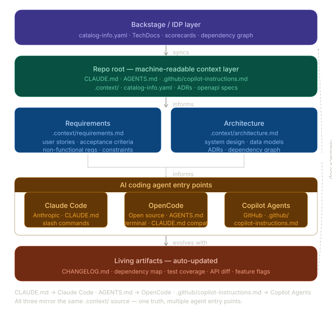

# HARC Framework

**Human Agentic Readable Context**

[](LICENSE)

Give AI coding assistants the context they need to work effectively on your projects. HARC provides a standard structure for project requirements, architecture, decisions, and constraints — readable by both humans and AI agents like Claude Code, GitHub Copilot, and OpenCode.

100% free and open source. Works with any language, any framework, any git host.

### Features

- [Context Structure](docs/context/features/context-structure.md) — Standard `docs/context/` directory for requirements, architecture, constraints, glossary, ADRs, and feature specs
- [AI Agent Entry Points](docs/context/features/agent-entry-points.md) — Synchronized entry point files for Claude Code, GitHub Copilot, and OpenCode
- [Bootstrap & Migration](docs/context/features/bootstrap-migration.md) — One-command scaffolding with `--agent` flag for selective agent setup and safe upgrades for existing repos
- [Living Artifacts](docs/context/features/living-artifacts.md) — AI agents automatically maintain `CHANGELOG.md`, `README.md` feature lists, and other evolving docs
- [Backstage Integration](docs/context/features/backstage-integration.md) — Optional IDP integration via `catalog-info.yaml` and TechDocs *(in progress)*
- [BMAD Method Compatibility](docs/context/features/bmad-compatibility.md) — Interoperability with the BMAD AI-driven agile method *(in progress)*
- [Spec Kit Interoperability](docs/context/features/spec-kit-interoperability.md) — Coexistence with GitHub Spec Kit's spec-driven development pipeline *(draft)*
- [In-Git Ticket System](docs/context/features/ticket-system.md) — Markdown tickets on an orphan branch with GitHub Issues sync *(draft)*



---

## Why HARC?

AI coding assistants start every session with **zero project knowledge**. Without context, they:
- Generate code that conflicts with your conventions
- Make decisions already made (and documented nowhere)
- Require you to re-explain the project every time
- Can't see requirements, constraints, or acceptance criteria

**HARC solves this** by providing:
- **Structured context files** that AI agents read automatically
- **A single source of truth** for requirements, architecture, and decisions
- **Living documentation** that evolves with your code
- **Backstage/IDP integration** for platform engineering teams (optional)

---

## Quick Start

### New Repository

Fork the template repo:
```bash
# Fork from: github.com/opencpk/aipk-template-base
```

### Existing Repository (New to HARC)

Run the bootstrap script:
```bash
curl -sL https://raw.githubusercontent.com/opencpk/aipk-framework-harc/main/scripts/bootstrap.sh | bash
```

For multiple AI agents (default is Claude Code only):
```bash
curl -sL https://raw.githubusercontent.com/opencpk/aipk-framework-harc/main/scripts/bootstrap.sh -o bootstrap.sh
chmod +x bootstrap.sh
./bootstrap.sh --agent claude,copilot,opencode
```

Or clone and run locally:
```bash
git clone https://github.com/opencpk/aipk-framework-harc.git
cp aipk-framework-harc/scripts/bootstrap.sh ./
chmod +x bootstrap.sh
./bootstrap.sh                                    # Claude Code only (default)
./bootstrap.sh --agent claude,copilot             # Claude + Copilot
./bootstrap.sh --agent claude,copilot,opencode    # All agents
```

### Adding HARC to an Existing Repository

The same bootstrap command works for existing repos. When a file already exists, a `-HARC` template is created alongside it for comparison — your existing files are never overwritten:

```bash
curl -sL https://raw.githubusercontent.com/opencpk/aipk-framework-harc/main/scripts/bootstrap.sh -o bootstrap.sh
chmod +x bootstrap.sh
./bootstrap.sh --agent claude,copilot,opencode
```

Then:
1. Find template files: `find . -name '*-HARC*' -type f`
2. Ask your AI agent to refactor each original file into the HARC format using the `-HARC` file as reference
3. Delete the `-HARC` template files when done: `find . -name '*-HARC*' -type f -delete`
4. Fill in remaining `[PLACEHOLDER]` values
5. Commit: `git commit -m "chore: adopt HARC context structure"`

### After Bootstrap

1. Fill in `[PLACEHOLDER]` values in generated files
2. Start with `CLAUDE.md` — it's what AI agents read first
3. Add your first ADR for any major decision already made
4. Commit: `git commit -m "chore: initialize HARC context"`

---

## What Gets Created

```
your-repo/
├── CLAUDE.md                    # Claude Code entry point (<80 lines)
├── AGENTS.md                    # OpenCode entry point
├── .github/
│   └── copilot-instructions.md  # GitHub Copilot instructions
├── catalog-info.yaml            # Backstage component descriptor (optional)
├── CHANGELOG.md                 # Living changelog (auto-updated by AI agents)
│
├── .claude/                     # Claude Code extensions
│   └── commands/                # Slash commands
│       ├── new-feature.md
│       ├── create-adr.md
│       ├── update-context.md
│       └── review-pr.md
│
├── docs/                        # Documentation + TechDocs source
│   ├── mkdocs.yml
│   ├── index.md
│   └── context/                 # Persistent project memory
│       ├── requirements.md      # What the system must do
│       ├── architecture.md      # How the system is designed
│       ├── constraints.md       # Rules that must not be broken
│       ├── glossary.md          # Domain language reference
│       ├── roadmap.md           # Project roadmap and planned milestones
│       ├── decisions/           # Architecture Decision Records
│       │   └── 0001-example.md
│       └── features/            # Feature specifications
│           └── example-feature.md
│
├── scripts/                     # Framework tooling
│   └── bootstrap.sh             # Bootstrap script (safe to re-run)
│
└── tests/                       # Test scripts
    └── test-bootstrap.sh        # Bootstrap test runner
```

---

## Key Concepts

### CLAUDE.md — The Entry Point

CLAUDE.md is the **first file Claude Code reads** at the start of every session. Keep it under 80 lines — it's a navigation document, not a documentation dump.

```markdown
# Project: My Service
> Handles billing for the platform.

## Stack
- Runtime: Node 20 / TypeScript
- Database: PostgreSQL 16

## Key context files
- Requirements: docs/context/requirements.md
- Architecture: docs/context/architecture.md

## Rules Claude must follow
- Never modify migrations directly
- All endpoints require OpenAPI annotations
```

### docs/context/ — Persistent Memory

The `docs/context/` directory is where all structured project knowledge lives:

| File                | Purpose                                    |
| ------------------- | ------------------------------------------ |
| `requirements.md`   | What the system must do (FRs/NFRs)         |
| `architecture.md`   | How the system is designed (with diagrams) |
| `constraints.md`    | Rules that must not be broken              |
| `glossary.md`       | Domain terms with specific meanings        |
| `roadmap.md`        | Project roadmap and planned milestones     |
| `decisions/`        | Architecture Decision Records (ADRs)       |
| `features/`         | Feature specs with acceptance criteria     |

### ADRs — Decision Records

Every significant architectural decision gets an ADR:

```markdown
# ADR-0001: Use PostgreSQL

## Status
Accepted

## Context
We need a relational database...

## Decision
We will use PostgreSQL 16...

## Consequences
- Positive: ACID compliance, JSON support
- Negative: Need to manage migrations
```

**ADRs are append-only** — never edit past decisions. To reverse, create a new ADR that supersedes.

---

## BMAD Method Compatibility

HARC is designed to work alongside the [BMAD Method](https://github.com/bmad-code-org/BMAD-METHOD):

| BMAD Concept       | HARC Equivalent                             |
| ------------------ | ------------------------------------------- |
| PRD                | `docs/context/requirements.md` + `features/`    |
| Architecture doc   | `docs/context/architecture.md`                  |
| ADRs               | `docs/context/decisions/`                       |
| Sprint status      | `tickets` branch (see below)                |
| Project context    | `CLAUDE.md` + `docs/context/constraints.md`     |

---

## In-Git Ticket System (Coming Soon)

HARC includes an optional ticket system stored in git:

- **Tickets as markdown** on an orphan `tickets` branch
- **Sync with GitHub Issues** via Actions
- **Agent coordination** — claim/lock/release for multi-agent work
- **Static site** — browse backlog as MkDocs site

See [ADR-0002](docs/context/decisions/0002-in-git-ticket-system.md) for full design.

---

## AI Tool Support

| Tool           | Entry Point                       | How It Works                  |
| -------------- | --------------------------------- | ----------------------------- |
| Claude Code    | `CLAUDE.md`                       | Reads at session start        |
| GitHub Copilot | `.github/copilot-instructions.md` | Reads at workspace open       |
| OpenCode       | `AGENTS.md`                       | Reads at session start        |
| Cursor         | `CLAUDE.md` or `.cursorrules`     | Configure in settings         |
| Backstage      | `catalog-info.yaml`               | Software catalog + TechDocs   |

---

## Slash Commands

HARC includes pre-built Claude Code commands in `.claude/commands/`:

| Command           | What It Does                                    |
| ----------------- | ----------------------------------------------- |
| `/new-feature`    | Scaffold feature spec + module boilerplate      |
| `/create-adr`     | Create numbered ADR from template               |
| `/update-context` | Sync `docs/context/` after significant changes      |
| `/review-pr`      | Run pre-merge checklist                         |

---

## CHANGELOG.md — Living Artifact

`CHANGELOG.md` follows the [Keep a Changelog](https://keepachangelog.com/) format and is treated as a **living artifact** — automatically updated by AI agents as part of their development workflow:

- **Claude Code** updates it via the `/update-context` slash command after completing features
- **GitHub Copilot** is instructed in `.github/copilot-instructions.md` to append entries under `[Unreleased]`
- **OpenCode** is instructed in `AGENTS.md` to append entries under `[Unreleased]`
- On release, rename `[Unreleased]` to the version number and date

This ensures the changelog stays current without manual maintenance.

---

## Backstage Integration (Optional)

HARC includes optional Backstage IDP integration. If your team uses Backstage, register your service with the included `catalog-info.yaml`:

```yaml
metadata:
  annotations:
    backstage.io/techdocs-ref: dir:.
    harc.dev/context-path: docs/context/
    harc.dev/entry-point: CLAUDE.md
```

Add scorecard rules to enforce context quality:
- `CLAUDE.md` modified in last 90 days
- `docs/context/architecture.md` exists
- At least one ADR exists

**Don't use Backstage?** Delete `catalog-info.yaml` and `docs/mkdocs.yml`. HARC works without Backstage — the `docs/context/` structure and AI entry points are the core value.

---

## Contributing

Contributions are welcome! See [CONTRIBUTING.md](CONTRIBUTING.md) for guidelines.

---

## License

Apache License 2.0 — see [LICENSE](LICENSE) for details.

---

## Links

- [HARC Documentation](docs/) — Framework guide, getting started, reference
- [Template Repo](https://github.com/opencpk/aipk-template-base) — Fork to get started
- [BMAD Method](https://github.com/bmad-code-org/BMAD-METHOD) — AI-driven agile development
- [Backstage](https://backstage.io/) — IDP framework (optional)

