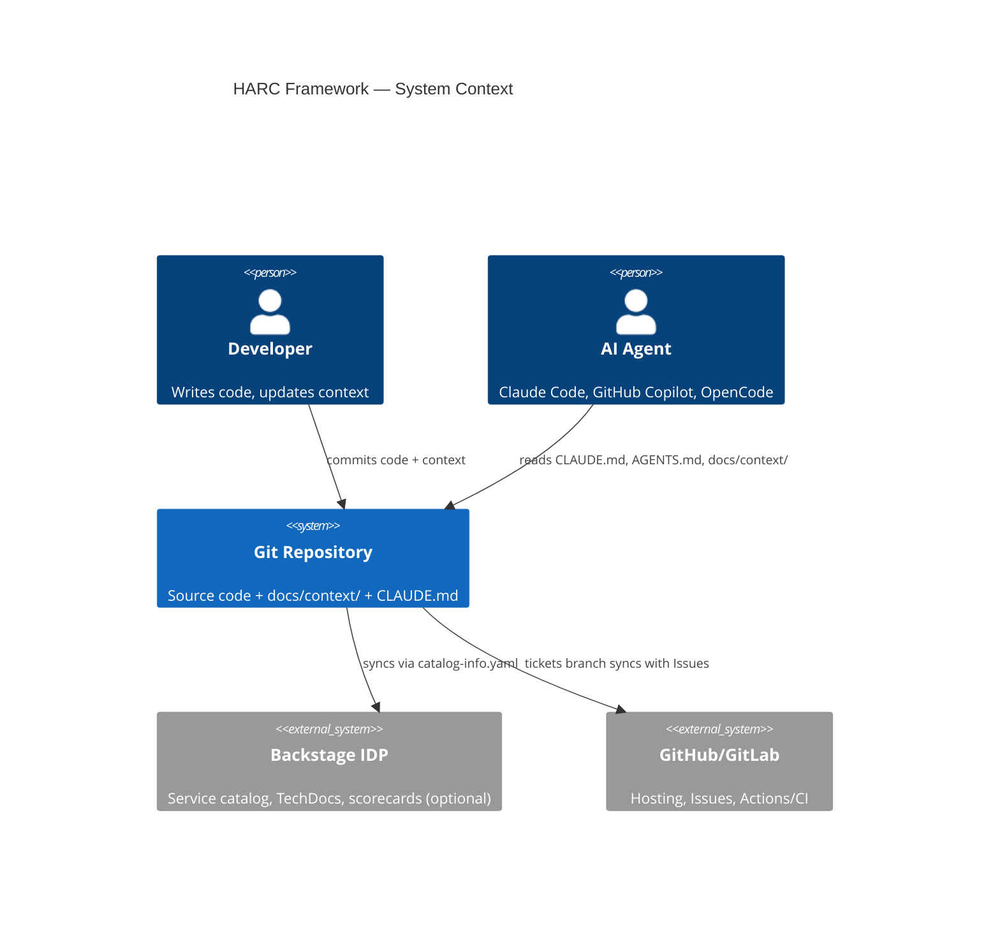
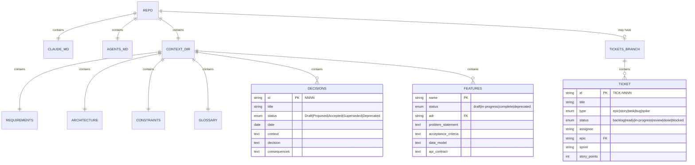
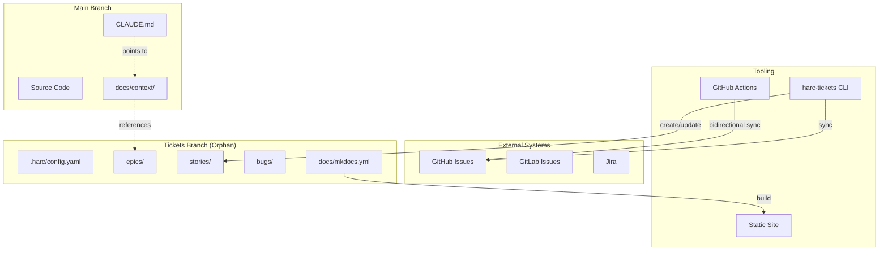

# Architecture


## System Context

HARC (Human Agentic Readable Context) is a framework, not an application. It defines:
1. A directory structure for AI-accessible project context
2. File formats and templates for context documents
3. Tooling conventions for AI agents and Backstage integration



## Component Overview

| Component                          | Responsibility                                              |
| ---------------------------------- | ----------------------------------------------------------- |
| `CLAUDE.md`                        | Claude Code entry point (navigation doc, <80 lines)         |
| `AGENTS.md`                        | OpenCode entry point (navigation doc, synced with CLAUDE.md)|
| `.github/copilot-instructions.md`  | GitHub Copilot workspace instructions                       |
| `docs/context/`                        | Persistent project memory (requirements, architecture, etc) |
| `docs/context/decisions/`              | Architecture Decision Records (ADRs)                        |
| `docs/context/features/`               | Feature specifications with acceptance criteria             |
| `.claude/commands/`                | Claude Code slash commands                                  |
| `CHANGELOG.md`                     | Living changelog (auto-updated by AI agents)                |
| `catalog-info.yaml`                | Backstage component descriptor (optional)                   |
| `docs/`                            | Human documentation (TechDocs source)                       |
| `tickets` branch                   | In-git agile ticket system (orphan branch)                  |

## Layered Architecture

```
┌─────────────────────────────────────────────────────────────────────┐
│  Layer 1: IDP / Backstage (Optional)                                    │
│  ─────────────────────────────────────────────────────────────────────  │
│  catalog-info.yaml → Software Catalog (if using Backstage)              │
│  docs/ + docs/context/ → TechDocs                                       │
│  Scorecard rules → Context quality enforcement                      │
└────────────────────────────────┬────────────────────────────────────┘
                                 │ syncs from repo
┌────────────────────────────────▼────────────────────────────────────┐
│  Layer 2: Repo Root — Machine-Readable Context                      │
│  ─────────────────────────────────────────────────────────────────  │
│  CLAUDE.md ─────────────────→ Claude Code reads first               │
│  AGENTS.md ─────────────────→ OpenCode reads first                  │
│  .github/copilot-instructions.md → GitHub Copilot reads             │
│  catalog-info.yaml ─────────→ Backstage registration (optional)     │
└────────────────────────────────┬────────────────────────────────────┘
                                 │
         ┌───────────────────────┴───────────────────────┐
         │                                               │
┌────────▼────────────────┐         ┌───────────────────▼─────────────┐
│  Layer 3a: Requirements │         │  Layer 3b: Architecture        │
│  ───────────────────────│         │  ─────────────────────────────  │
│  docs/context/requirements.md         │  docs/context/architecture.md      │
│  docs/context/features/     │         │  docs/context/decisions/           │
│  docs/context/glossary.md   │         │  OpenAPI specs, schemas        │
└────────────────────────┬┘         └──────────────────┬──────────────┘
                         │                             │
                         └──────────────┬──────────────┘
                                        │ informs
┌───────────────────────────────────────▼─────────────────────────────┐
│  Layer 4: AI Agent Entry Points                                     │
│  ─────────────────────────────────────────────────────────────────  │
│  CLAUDE.md (root) + CLAUDE.md (per-module)                          │
│  AGENTS.md (root) — OpenCode entry point                            │
│  .claude/commands/ (slash commands)                                 │
│  .github/copilot-instructions.md                                    │
└───────────────────────────────────────┬─────────────────────────────┘
                                        │ produces + updates
┌───────────────────────────────────────▼─────────────────────────────┐
│  Layer 5: Living Artifacts                                          │
│  ─────────────────────────────────────────────────────────────────  │
│  CHANGELOG.md · test coverage · API diff · dependency map           │
└─────────────────────────────────────────────────────────────────────┘
```

## Key Design Decisions

| Decision                               | ADR                                                         | Status   |
| -------------------------------------- | ----------------------------------------------------------- | -------- |
| Adopt HARC Framework                   | [ADR-0001](decisions/0001-harc-framework-adoption.md)       | Proposed |
| In-Git Ticket System                   | [ADR-0002](decisions/0002-in-git-ticket-system.md)          | Proposed |
| AI Instruction File Sync               | [ADR-0003](decisions/0003-ai-instruction-sync.md)           | Proposed |
| Add OpenCode Support                   | [ADR-0004](decisions/0004-opencode-support.md)              | Proposed |

## Data Model

HARC does not define application data models. Instead, it defines **document structures**:

### Context File Structure



## Ticket System Architecture

See [ADR-0002](decisions/0002-in-git-ticket-system.md) for full details.



## External Dependencies

| Dependency       | Purpose                     | Required |
| ---------------- | --------------------------- | -------- |
| Git              | Version control             | Yes      |
| GitHub/GitLab    | Hosting, Issues, CI         | Yes      |
| Python 3.x       | CLI tooling                 | Yes (for ticket system) |
| MkDocs           | Static site generation      | Optional |
| Backstage        | IDP integration             | Optional |

## Security Considerations

- No secrets stored in context files
- Ticket files may reference issue numbers but not sensitive data
- Branch protection on `tickets` branch recommended
- `locked_by` field should use opaque session IDs, not credentials
