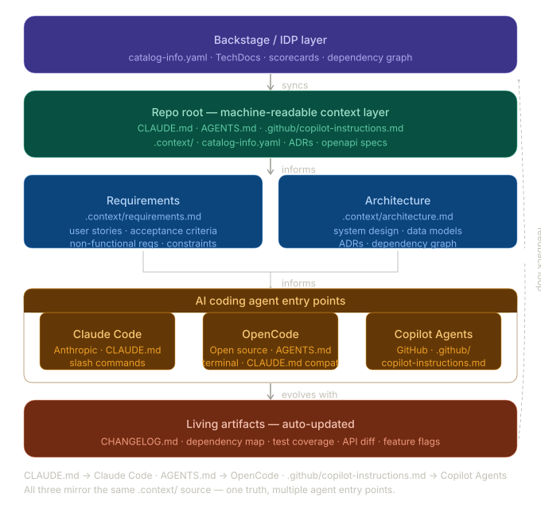

# HARC - Human Agentic Readable Context

> **For humans and machines alike.**
> This document explains how to structure a code repository so that both developers and Claude Code (AI coding assistant) always have the context they need — and so that context evolves with the codebase rather than rotting alongside it.

---

## Table of Contents

- [HARC - Human Agentic Readable Context](#harc---human-agentic-readable-context)
  - [Table of Contents](#table-of-contents)
  - [1. Why This Exists](#1-why-this-exists)
  - [2. Core Principle](#2-core-principle)
  - [3. Architecture Overview](#3-architecture-overview)
  - [4. Layer-by-Layer Reference](#4-layer-by-layer-reference)
    - [4.1 Backstage / IDP Layer (Optional)](#41-backstage--idp-layer-optional)
    - [4.2 AI Agent Entry Points](#42-ai-agent-entry-points)
    - [4.3 The `docs/context/` Directory](#43-the-docscontext-directory)
      - [`docs/context/requirements.md`](#docscontextrequirementsmd)
      - [`docs/context/architecture.md`](#docscontextarchitecturemd)
      - [`docs/context/constraints.md`](#docscontextconstraintsmd)
      - [`docs/context/decisions/` — Architecture Decision Records (ADRs)](#docscontextdecisions--architecture-decision-records-adrs)
      - [`docs/context/features/` — Feature Specifications](#docscontextfeatures--feature-specifications)
      - [`docs/context/glossary.md`](#docscontextglossarymd)
      - [`docs/context/roadmap.md`](#docscontextroadmapmd)
    - [4.4 The `.claude/` Directory](#44-the-claude-directory)
      - [`.claude/commands/`](#claudecommands)
    - [4.5 TechDocs (`docs/`) — Optional](#45-techdocs-docs--optional)
  - [5. File Reference](#5-file-reference)
  - [6. The Evolution Model](#6-the-evolution-model)
    - [On feature development](#on-feature-development)
    - [On architectural decisions](#on-architectural-decisions)
    - [On sprint transitions](#on-sprint-transitions)
    - [PR review checklist](#pr-review-checklist)
  - [7. Enforcing This via Backstage Scorecards (Optional)](#7-enforcing-this-via-backstage-scorecards-optional)
  - [8. Anti-Patterns to Avoid](#8-anti-patterns-to-avoid)
  - [9. Bootstrapping a New Repo](#9-bootstrapping-a-new-repo)
    - [After Running](#after-running)
    - [Testing the Bootstrap Script](#testing-the-bootstrap-script)

---

## 1. Why This Exists

Modern platform engineering has evolved from DevSecOps into **Internal Developer Platforms (IDPs)** — the goal being to reduce cognitive load on developers by providing golden paths, self-service tooling, and a shared understanding of every service in the system.

AI coding assistants like **Claude Code**, **GitHub Copilot**, and **OpenCode** introduce a new consumer of that shared understanding: the AI itself. For AI agents to be genuinely useful on a project, they need:

- What the project is and does (purpose, domain, bounded context)
- What it must do (requirements, acceptance criteria)
- How it is designed (architecture, data models, API contracts)
- What decisions have been made and why (ADRs)
- What rules it must follow (coding standards, security constraints, forbidden patterns)
- What is currently being worked on (sprint focus, open questions)

Without this, every AI session starts from zero. With it, AI agents become **stateful collaborators** that understand the project as well as any new team member who has read the docs.

This architecture ensures the same source files serve:

| Consumer            | How they use it                                                                             |
| ------------------- | ------------------------------------------------------------------------------------------- |
| Human developers    | Read `docs/context/` and `CLAUDE.md` to onboard, review decisions, understand constraints       |
| Claude Code         | Reads `CLAUDE.md` as entry point, navigates `docs/context/` for depth                           |
| GitHub Copilot      | Reads `.github/copilot-instructions.md`, navigates `docs/context/` for depth                    |
| OpenCode            | Reads `AGENTS.md` as entry point, navigates `docs/context/` for depth                           |
| Backstage / IDP     | Reads `catalog-info.yaml` for the software catalog; renders `docs/context/` + `docs/` as TechDocs (optional) |
| CI/CD pipelines     | Validates context files exist and are up to date via scorecard checks                       |

---

## 2. Core Principle

> **Context files are first-class code artifacts, not documentation afterthoughts.**

They are edited in the same PR that changes the code. They are reviewed in code review. They are enforced by the platform. They are never allowed to become stale because the process does not allow a PR to close without updating them if the change warrants it.

This is the single most important rule. Everything else is implementation detail.

---

## 3. Architecture Overview



```
┌─────────────────────────────────────────────────────────────────┐
│  BACKSTAGE / IDP (Optional)                                     │
│  catalog-info.yaml · TechDocs · scorecards · dependency graph   │
└────────────────────────┬────────────────────────────────────────┘
                         │ syncs from repo
┌────────────────────────▼───────────────────────────────────────┐
│  REPO ROOT — machine-readable context layer                    │
│  CLAUDE.md · AGENTS.md · catalog-info.yaml · docs/context/ · .claude/ │
└────────────┬───────────────────────────────┬───────────────────┘
             │                               │
┌────────────▼──────────┐   ┌───────────────▼───────────────────┐
│  REQUIREMENTS         │   │  ARCHITECTURE                     │
│  docs/context/            │   │  docs/context/architecture.md         │
│  requirements.md      │   │  docs/context/decisions/              │
│  features/            │   │  openapi specs                    │
└────────────┬──────────┘   └───────────────┬───────────────────┘
             │                              │
             └──────────────┬───────────────┘
                            │ informs
┌───────────────────────────▼───────────────────────────────────┐
│  AI AGENT ENTRY POINTS                                        │
│  CLAUDE.md (Claude Code) · AGENTS.md (OpenCode)                │
│  .github/copilot-instructions.md (Copilot)                     │
│  .claude/commands/ (slash commands)                            │
└───────────────────────────┬───────────────────────────────────┘
                            │ produces + updates
┌───────────────────────────▼───────────────────────────────────┐
│  LIVING ARTIFACTS (auto-updated)                              │
│  CHANGELOG.md · API diff · test coverage · feature flag index │
└───────────────────────────────────────────────────────────────┘
```

The feedback loop: as AI agents build features, they are instructed to update `docs/context/` files in the same PR. Context therefore evolves with the code, never behind it.

---

## 4. Layer-by-Layer Reference

### 4.1 Backstage / IDP Layer (Optional)

**File:** `catalog-info.yaml` (repo root)

This is the Backstage [Component Descriptor](https://backstage.io/docs/features/software-catalog/descriptor-format). It registers the service in the software catalog and links it to its context files, owner team, dependencies, and API contracts.

> **Note:** Backstage integration is optional. If your team does not use Backstage, you can safely delete `catalog-info.yaml` and `docs/mkdocs.yml`. HARC works without Backstage — the `docs/context/` structure and AI entry points are the core value.

Key annotations for HARC integration:

```yaml
annotations:
  backstage.io/techdocs-ref: dir:.        # renders docs/ as TechDocs
  harc.dev/context-path: docs/context/        # where AI agents find context
  harc.dev/entry-point: CLAUDE.md         # Claude Code's first file to read
```

**What belongs here:**
- Component name, title, description
- Owner (team group)
- Lifecycle (experimental / production / deprecated)
- Dependencies (`dependsOn`, `providesApis`, `consumesApis`)
- Links to runbooks, dashboards, on-call docs

**What does NOT belong here:**
- Requirements, architecture detail, feature specs — those go in `docs/context/`
- Secrets, credentials, environment-specific configuration

---

### 4.2 AI Agent Entry Points

Each supported AI tool has its own entry point file at the repo root:

| File                              | Tool           | Read When                |
| --------------------------------- | -------------- | ------------------------ |
| `CLAUDE.md`                       | Claude Code    | Start of each session    |
| `.github/copilot-instructions.md` | GitHub Copilot | Workspace open           |
| `AGENTS.md`                       | OpenCode       | Start of each session    |

All entry points must be **navigation documents** — concise, scannable, and pointing to deeper files in `docs/context/` rather than containing everything themselves. They must stay synchronized (see [ADR-0003](docs/context/decisions/0003-ai-instruction-sync.md)).

Think of them as the README for the AI. A human reads `README.md`; AI agents read their respective entry point.

**Structure (same for all three):**

```markdown
# Project: [Name]
> One-sentence description.

## What this project does
2–3 sentences maximum. Domain context, not technical detail.

## Stack
Bullet list: runtime, framework, database, infra, CI/CD.

## Key context files
Explicit paths to docs/context/ files Claude should read for depth.

## Rules the agent must follow
Non-negotiable constraints: coding standards, security rules,
patterns that are forbidden, tools that must be used.

## Current sprint focus
Updated each sprint. What the agent should prioritise right now.

## How to run common tasks
Links to .claude/commands/ for reusable workflows.
```

**Rules for maintaining entry point files:**
- The stack section must be updated when dependencies change
- The "Current sprint focus" section is updated at sprint start
- Rule additions require team review (this is effectively a policy file)
- When one entry point is updated, the other two must be updated to match
- `CLAUDE.md` files in sub-modules inherit root rules unless they explicitly override
- All entry point files must instruct agents to update `CHANGELOG.md` after changes

---

### 4.3 The `docs/context/` Directory

This is the **persistent memory** of the project. Every file here is designed to be read by both humans and Claude Code, and rendered by Backstage TechDocs.

#### `docs/context/requirements.md`

Captures **what the system must do**. Written before code, updated as understanding evolves.

Structure:
- Business context and problem statement
- Functional requirements (feature-level, linked to `features/`)
- Non-functional requirements (performance, availability, security, compliance)
- Known constraints (tech choices that are fixed, regulatory requirements)
- Out of scope (explicit exclusions to prevent scope creep)

#### `docs/context/architecture.md`

Captures **how the system is designed**. Contains or links to:
- System context diagram (Mermaid C4 or similar)
- Component breakdown and responsibilities
- Data model overview (with link to full schema or Prisma file)
- Key technical decisions (with links to ADRs)
- External dependencies and integration points
- Deployment topology

Use [Mermaid](https://mermaid.js.org/) diagrams — they render in GitHub, GitLab, and Backstage TechDocs without any tooling.

#### `docs/context/constraints.md`

Captures **rules that must not be broken**. This is the file Claude Code uses to understand what it is and is not allowed to do. Be explicit and opinionated.

Examples of what belongs here:
- "All database migrations must be generated via `pnpm db:generate`, never written by hand"
- "Feature flags must use `src/lib/flags.ts` — no environment variable conditionals in application code"
- "Adding a new third-party dependency requires an ADR"
- "All HTTP endpoints must have OpenAPI annotations before merging"
- Security mandates, compliance controls, data handling rules

#### `docs/context/decisions/` — Architecture Decision Records (ADRs)

One file per significant architectural decision. Named `NNNN-short-title.md`.

Standard ADR format:
```
# ADR-0001: Use PostgreSQL as the primary database

## Status
Accepted | Superseded by ADR-0012 | Deprecated

## Context
What situation prompted this decision?

## Decision
What was decided?

## Consequences
What becomes easier? What becomes harder? What must now be true?
```

ADRs are **append-only**. Never edit a past ADR's decision. If the decision changes, write a new ADR that supersedes it.

#### `docs/context/features/` — Feature Specifications

One file per feature or significant capability. This is where requirements, acceptance criteria, data model changes, and API contracts live at the feature level.

Standard feature spec format:
```
# Feature: [Name]
## Status: draft | in-progress | complete | deprecated
## ADR: [link if architectural decision was needed]

## Problem statement
## Acceptance criteria (checkboxes)
## Data model changes
## API contract
## Non-functional requirements
## Out of scope
## Open questions
```

Claude Code reads the relevant feature spec before building a feature, ensuring it builds to spec rather than guessing intent.

#### `docs/context/glossary.md`

Domain language reference. Defines terms that have specific meaning in this bounded context and may differ from their everyday meaning or from usage in other services.

This prevents Claude Code from making incorrect assumptions about domain vocabulary.

#### `docs/context/roadmap.md`

A living roadmap that tracks the planned evolution of the project. Captures the project vision, completed milestones, in-progress work, and planned phases.

AI agents read this file to understand what is planned, what is actively being worked on, and what has been delivered — helping them make better decisions about where to focus effort and avoid working on features that are not yet planned or have been deprioritized.

---

### 4.4 The `.claude/` Directory

Reusable workflows and slash commands for Claude Code. These encode your team's process so it is repeatable and consistent.

#### `.claude/commands/`

Each `.md` file is a slash command. The filename becomes the command name (e.g., `new-feature.md` → `/new-feature`).

**Key commands to implement:**

| Command | Purpose |
|---|---|
| `/new-feature [name]` | Scaffold feature spec + module boilerplate + test skeleton |
| `/create-adr [topic]` | Create a new ADR with correct numbering |
| `/update-context` | Sync `docs/context/` files after a significant change |
| `/review-pr` | Run pre-merge checklist against context and code |
| `/onboard` | Produce a summary of the project for a new team member |

Commands are written as natural-language instructions to Claude Code. They can reference other context files, perform multi-step workflows, and include conditional logic ("if a new dependency is needed, pause and ask before proceeding").

---

### 4.5 TechDocs (`docs/`) — Optional

**File:** `docs/mkdocs.yml` + markdown files under `docs/`

If using Backstage, TechDocs renders these as a browsable documentation site within the IDP. The key insight is that `docs/` can include the same `docs/context/` files by reference — one source, two renderers (GitHub/GitLab markdown + Backstage TechDocs).

If not using Backstage, `docs/` can still serve as a MkDocs site published to GitHub Pages.

If neither is needed, `docs/` can be deleted — the `docs/context/` files are the core value.

```yaml
# docs/mkdocs.yml
site_name: "[Service Name] Documentation"
nav:
  - Overview: index.md
  - Requirements: ../context/requirements.md   # same source files
  - Architecture: ../context/architecture.md
  - Decisions: ../context/decisions/
  - Features: ../context/features/
  - Development Guide: development.md
```

---

## 5. File Reference

```
repo-root/
│
├── CLAUDE.md                          # Claude Code entry point
├── AGENTS.md                          # OpenCode entry point
├── .github/
│   └── copilot-instructions.md        # GitHub Copilot entry point
├── catalog-info.yaml                  # Backstage component descriptor (optional)
├── CHANGELOG.md                       # Living artifact. Updated by AI agents.
│
├── docs/context/
│   ├── requirements.md                # What the system must do
│   ├── architecture.md                # How the system is designed
│   ├── constraints.md                 # Rules that must not be broken
│   ├── glossary.md                    # Domain language reference
│   ├── roadmap.md                     # Project roadmap and planned milestones
│   ├── decisions/
│   │   └── 0001-example-decision.md   # ADR template (rename for your first decision)
│   └── features/
│       └── example-feature.md         # Feature spec template (copy for each feature)
│
├── .claude/
│   └── commands/
│       ├── new-feature.md             # /new-feature slash command
│       ├── create-adr.md              # /create-adr slash command
│       ├── update-context.md          # /update-context slash command
│       └── review-pr.md               # /review-pr slash command
│
└── docs/
    ├── mkdocs.yml                     # Backstage TechDocs config (optional)
    └── index.md                       # TechDocs landing page (optional)
```

---

## 6. The Evolution Model

The system only works if context stays current. Here is the process:

### On feature development

1. Before starting: AI agent reads its entry point (`CLAUDE.md` / `AGENTS.md` / `copilot-instructions.md`) → relevant `features/` spec → `constraints.md`
2. During development: Agent references `architecture.md` for patterns to follow
3. On completion: Context is updated — acceptance criteria checkboxes, `architecture.md` if design changed, `CHANGELOG.md`, and the stack section of entry point files if dependencies changed

### On architectural decisions

1. Engineer or AI agent identifies a significant decision point
2. `/create-adr [topic]` is run (or ADR created manually) — creates a new ADR with correct numbering
3. ADR is reviewed and merged with the code change
4. `architecture.md` is updated to reference the new ADR

### On sprint transitions

1. "Current sprint focus" in all AI entry point files is updated
2. New feature specs are created in `docs/context/features/` for the incoming sprint's work
3. Completed feature specs are marked `Status: complete`

### PR review checklist

Before merging any significant PR, verify:
- [ ] If the architecture changed, `architecture.md` is updated
- [ ] If a new dependency was added, an ADR exists
- [ ] If a feature is complete, acceptance criteria are checked off
- [ ] If a new constraint was identified, `constraints.md` is updated
- [ ] `CLAUDE.md` stack section reflects the current state
- [ ] All AI entry point files are synchronized
- [ ] `CHANGELOG.md` has an entry under `[Unreleased]`

---

## 7. Enforcing This via Backstage Scorecards (Optional)

If using Backstage, add scorecard rules that verify context file presence. Teams that maintain good context scores get higher trust levels in the IDP (faster deployments, fewer manual gates).

If not using Backstage, these checks can be implemented as CI pipeline steps in GitHub Actions or GitLab CI.

Example scorecard/CI checks:
- `CLAUDE.md` exists and was modified in the last 90 days
- `docs/context/requirements.md` exists
- `docs/context/architecture.md` exists and contains a Mermaid diagram
- At least one ADR exists in `docs/context/decisions/`
- `catalog-info.yaml` has `harc.dev/context-path` annotation (if using Backstage)

---

## 8. Anti-Patterns to Avoid

| Anti-pattern | Why it fails | What to do instead |
|---|---|---|
| Requirements in Confluence | AI agents cannot read it; it becomes stale and disconnected | Keep requirements in `docs/context/requirements.md` |
| Single flat `README.md` | Too long, unstructured, AI agents can't navigate it efficiently | Use entry point files as navigator, `docs/context/` for depth |
| Writing docs after the code | Docs are always stale by definition | Write feature specs before building; update in the same PR |
| Giant `CLAUDE.md` | Agent reads it all; a 500-line file wastes context window | `CLAUDE.md` should be under 80 lines; depth goes in `docs/context/` |
| ADRs that get edited | Loses the audit trail of how thinking evolved | ADRs are append-only; write a new one that supersedes |
| Context files not in version control | Can't track changes, can't review, can't enforce | Everything in the repo, no exceptions |
| One CLAUDE.md for a monorepo | Too much noise for module-level work | Root `CLAUDE.md` for global rules; per-package `CLAUDE.md` for module context |
| AI entry points out of sync | Different agents follow different rules | All three files must be synchronized (see ADR-0003) |

---

## 9. Bootstrapping a New Repo

A bootstrap script is provided at **`scripts/bootstrap.sh`**.

It creates the full directory structure with commented template content in every file. Run it at the root of a new (or existing) repository:

```bash
chmod +x scripts/bootstrap.sh
./scripts/bootstrap.sh
```

The script is safe for both new and existing repos:
- **New files** are created directly with `[PLACEHOLDER]` values
- **Existing files** are preserved — a `-HARC` template is created alongside them for comparison

For existing repos with `-HARC` templates:

1. Find template files: `find . -name '*-HARC*' -type f`
2. Ask your AI agent to refactor each original file into the HARC format using the `-HARC` file as reference
3. Delete the `-HARC` template files: `find . -name '*-HARC*' -type f -delete`
4. Fill in remaining `[PLACEHOLDER]` values

### After Running

1. Fill in all `[PLACEHOLDER]` values in the generated files
2. Run `git add docs/context/ .claude/ .github/ docs/ CLAUDE.md AGENTS.md catalog-info.yaml CHANGELOG.md`
3. Commit as the first context commit: `git commit -m "chore: initialise HARC context"`
4. Optionally register the component in your Backstage instance by pointing it at `catalog-info.yaml`
5. If not using Backstage, delete `catalog-info.yaml` and `docs/mkdocs.yml`

### Testing the Bootstrap Script

```bash
# Run all tests (default):
./tests/test-bootstrap.sh

# Test fresh repo only:
./tests/test-bootstrap.sh --fresh

# Test existing repo only:
./tests/test-bootstrap.sh --existing

# Test upgrade scenario only:
./tests/test-bootstrap.sh --upgrade
```

Test output goes to `test-results/bootstrap/` (gitignored).

---

*This document is itself an example of what belongs in `docs/context/`. In a real project, this content would be split across the individual files described above, with this document living at `docs/platform-context-guide.md` and referenced from TechDocs.*